[README.md](https://github.com/user-attachments/files/34763281/README.md)
# PENETRATION-TESTING-REPORT-# PENETRATION TESTING REPORT

### Footprinting & Network Scanning Phases

**W2-PM-FINAL | CYBERSECURITY | NETWORKWALKS**

| Field | Detail |
| --- | --- |
| **Pentester Name (Cybersecurity Intern)** | **Naadiya Sabrin** |
| **Program/Batch** | B084-Networkwalks |
| **Date** | 12 November 2026 |
| **Modules completed** | W2-PM1 (Multiple Kali Tools) W2-PM3 (Maltego) W2-PM4 (theHarvester) W2-PM5 (Zenmap Scanning) |
| **Client/Target** | 1. Networkwalks (secured written permission already) 2. My own local LAN network |
| **Permission secured from client?** | Yes (Letter of Authorization) |
| **Phases covered** | **Phase 1:** Reconnaissance & Footprinting **Phase 2:** Scanning & Network Discovery **Phase 3-5:** In Progress |

---

# 1. Liability Disclaimer

I have performed these activities only on the systems & devices where I had secured written permission or the devices/systems that I own myself. All these materials are for education and research purpose only. Do not use anything from here to break the law. The instructor, the authors and Networkwalks are not responsible for what you do with this knowledge. Every action you take is your own responsibility. Misuse can lead to criminal charges, heavy fines, loss of your job and a permanent record. In most countries unauthorised access is a crime even when nothing is damaged.

# 2. Introduction

This report covers footprinting the `networkwalks.com` domain using multiple Kali Linux tools (W2-PM1) and Maltego (W2-PM3), a passive OSINT exercise with theHarvester (W2-PM4), and scanning my own local network with Zenmap (W2-PM5). Three modules cover the footprinting phase and one covers the scanning phase, so together they show how an attacker moves from gathering public information to mapping live hosts on a network. It is the Week 2 part of my ongoing internship program at Networkwalks.

The footprinting commands were run in a Kali Linux virtual machine (VirtualBox). Maltego and Zenmap were run on my Windows laptop. Every step below includes the exact command or action used, the result I observed, a screenshot as evidence, and a short note on why the finding matters from an attacker's point of view.

# 3. Tools Used

| Tool | Purpose |
| --- | --- |
| Kali Linux (VirtualBox) & Windows | Operating systems used for reconnaissance and scanning |
| WHOIS | Find domain registration details (registrar, dates, name servers) |
| whatweb | Fingerprint web technologies (server, CMS, plugins, IP) |
| nslookup | Resolve the domain name to its IP address using DNS |
| curl -I | Read the HTTP response headers of the website |
| wafw00f | Detect whether a Web Application Firewall protects the site |
| dnsrecon | Enumerate DNS records (SOA, NS, MX, A, TXT, SRV) |
| Maltego | Graph-based OSINT: run transforms on a domain and map what comes back |
| theHarvester | Collect hosts, emails and IPs for a domain from public search sources |
| Zenmap (Nmap GUI) | Scan the local subnet to find live hosts, IPs and MAC addresses |
| Windows CMD (`ipconfig`) | Local IP address and subnet identification |

# 4. Activities Performed

## 4.1 Footprinting & Reconnaissance with Kali Tools (W2-PM1)

I performed reconnaissance against the `networkwalks.com` domain using six Kali Linux tools: **WHOIS, WhatWeb, Nslookup, Curl, Wafw00f and DNSRecon**. Each tool collects a different type of information about the target.

**WHOIS** (`whois networkwalks.com`) showed the domain is registered with GoDaddy, created on 6 November 2019 and registered until 6 November 2027. The name servers are `NS6135.HOSTGATOR.COM` and `NS6136.HOSTGATOR.COM`, which tells me the site is hosted with HostGator. DNSSEC is **unsigned**. The registrant details are hidden behind a privacy service (Domains By Proxy), so no personal owner details are exposed.

**WhatWeb** (`whatweb networkwalks.com`) showed the site is built on **WordPress 7.1.4** with the **WordPress Download Manager 3.3.76** plugin, runs on an **Apache** web server, uses jQuery 3.7.1 and Google Tag Manager, and resolves to **192.232.216.135**. HTTP is redirected to HTTPS (301). It also exposed the contact email **info@networkwalks.com**.

**Nslookup** (`nslookup networkwalks.com`) resolved the domain to **192.232.216.135** using Google's DNS server (8.8.8.8).

**Curl** (`curl -I https://networkwalks.com`) returned `HTTP/2 200` and the response headers. They revealed the server type (Apache), the WordPress REST API endpoint **`/wp-json/`** in the `link` header, and caching headers (`x-nginx-cache: WordPress`, `x-endurance-cache-level: 0`). The session cookie is set with the `secure` and `HttpOnly` flags. I did not see `Strict-Transport-Security`, `X-Frame-Options`, `X-Content-Type-Options` or `Content-Security-Policy` headers in this response.

**Wafw00f** (`wafw00f networkwalks.com`) reported that the site is behind a **ModSecurity (SpiderLabs)** Web Application Firewall.

**DNSRecon** (`dnsrecon -d networkwalks.com`) enumerated the DNS records:

- SOA and NS records pointing to `ns6135.hostgator.com` (50.87.144.87) and `ns6136.hostgator.com` (192.232.216.131). Both name servers disclosed their DNS software version, **BIND 9.16.23-RH**.
- An MX record, `mail.networkwalks.com`, on the same IP as the website (192.232.216.135).
- TXT records: a Google site verification record and an SPF record (`v=spf1 +a +mx +ip4:50.87.144.87 +include:websitewelcome.com ~all`), which uses a soft fail (`~all`).
- 8 SRV records for `_autodiscover._tcp` pointing to `cpanelemaildiscovery.cpanel.net`.
- No answer to the DNSSEC query, which matches the unsigned DNSSEC seen in WHOIS.

## 4.2 Footprinting with Maltego (W2-PM3)

I downloaded and installed **Maltego Graph (Desktop) 4.14.0** on my Windows laptop and created a new graph. I dragged a **Domain** entity from the Entity Palette onto the graph and set it to `networkwalks.com`.

I then ran the transform **To Emails @domain [Search Engine]** on that entity. The transform output shows it consumed 10 credits (190 remaining) and completed in about 15 seconds with 1 new entity. The graph now shows the domain linked to one email address: **info@networkwalks.com**. This matches the address WhatWeb found, which confirms the same address is publicly discoverable from two different tools.

## 4.3 Footprinting with theHarvester (W2-PM4)

I used theHarvester 4.11.1 in Kali Linux for passive information gathering. This tool queries public sources such as search engines, so no traffic is sent directly to the target's own systems. For this module I used the well-known public domain `microsoft.com` as the example.

**Command:** `theHarvester -d microsoft.com -l 1000 -b baidu`

**Result:** using the Baidu search source with a limit of 1000 results, theHarvester found **9 hosts** and no emails, IPs or people:

`account.microsoft.com`, `docs.microsoft.com`, `graph.microsoft.com`, `learn.microsoft.com`, `msdn.microsoft.com`, `msrc.microsoft.com`, `opensource.microsoft.com`, `support.microsoft.com` and one malformed entry (`2Fsupport.microsoft.com`, a URL-encoding leftover).

I also ran theHarvester across many sources at once. Most of them failed with *Missing API key* warnings because they need a free or paid API key (for example Shodan, VirusTotal, Venacus and Zoomeye), and a few returned errors such as an invalid Fofa credential. This showed me that the free sources give limited results, and that API keys are needed for thorough OSINT.

## 4.4 Network Scanning with Zenmap (W2-PM5)

I downloaded and installed **Zenmap** from the official website on my Windows laptop. I used `ipconfig` to identify my local IP address (**192.168.21.218**) and LAN subnet (**192.168.21.0/24**). I entered the subnet into Zenmap and selected the **Ping scan** profile, which runs `nmap -sn 192.168.21.0/24`.

The scan checked 256 IP addresses in 34.91 seconds and found **2 live hosts**:

| # | IP address | MAC address | Notes |
| --- | --- | --- | --- |
| 1 | 192.168.21.28 | 3A:9A:18:XX:XX:XX | Other device on my network (latency 0.060 s) |
| 2 | 192.168.21.218 | EC:3A:56:XX:XX:XX | My own laptop |

*The last three bytes of each MAC address are hidden for privacy.*

Finally, I opened the **Topology** tab in Zenmap, enabled the legend and saved the network topology as a PDF as required by the practical task.

# 5. Risk Analysis / Impact

Based on the information collected during the footprinting and network scanning activities, I identified the following potential risks.

| # | Risk / Finding | Evidence / Observation | Potential Impact | Risk Level |
| --- | --- | --- | --- | --- |
| 1 | Web technology and version information exposed | WhatWeb identified WordPress 7.1.4 and WP Download Manager 3.3.76 | Attackers may use exposed software and version information to look for known weaknesses in them | 🟠 **Medium** |
| 2 | Server IP address identifiable | Nslookup resolved the domain to `192.232.216.135` | Shows the network location of the web service; the mail server shares the same IP | 🟢 **Low** |
| 3 | HTTP technical information exposed, security headers not seen | Curl showed `/wp-json/`, caching headers, and no HSTS, X-Frame-Options, X-Content-Type-Options or CSP header | Helps fingerprinting; missing headers give less browser-side protection | 🟢 **Low** |
| 4 | WAF technology identifiable | Wafw00f identified ModSecurity (SpiderLabs) | Reveals part of the web application's security architecture (although it is good that a WAF is present) | 🟢 **Low** |
| 5 | DNS infrastructure details exposed | DNSRecon showed BIND 9.16.23-RH on both name servers, an SPF soft fail (`~all`), unsigned DNSSEC, and autodiscover SRV records | Version disclosure and weaker DNS/email protections help attackers build an infrastructure profile | 🟠 **Medium** |
| 6 | Public email address discoverable | `info@networkwalks.com` found by both WhatWeb and Maltego | Public addresses can be targeted by phishing or spam | 🟢 **Low** |
| 7 | Public hosts discoverable through search engines | theHarvester found 9 hosts for the example domain using only Baidu | Passive sources alone can reveal an organization's subdomains | 🟢 **Low** |
| 8 | Unverified device visible on local network | Zenmap found 2 live hosts, one of which (192.168.21.28) is not my laptop | Unknown devices on a network should be identified and verified | 🟢 **Low** |

**Risk level key:** 🔴 Critical &nbsp; 🟠 Medium &nbsp; 🟢 Low

**Positive observations:** the WHOIS registrant details are hidden behind a privacy service, HTTP redirects to HTTPS, the session cookie has the `secure` and `HttpOnly` flags, and a ModSecurity WAF is in place.

The risks above are observations from the footprinting and scanning exercises, not confirmed vulnerabilities.

The practical exercises primarily involved information gathering and host discovery. No exploitation or vulnerability validation was performed as part of these modules.

Therefore, the presence of information such as a software version, IP address, email address or DNS record does not by itself mean that the system is vulnerable. Further authorized security testing would be required to confirm any actual vulnerability.

# 6. Recommendations

Based on the observations from these activities, I recommend the following security improvements:

1. **Review publicly exposed technology information**
   Organizations should regularly review what information about their web technologies, CMS and plugins is publicly visible, and consider hiding version numbers such as the WordPress generator tag.

2. **Keep software updated**
   WordPress, its plugins and other web technologies should be regularly updated and reviewed against current security advisories.

3. **Review HTTP headers**
   Add security headers such as `Strict-Transport-Security`, `X-Content-Type-Options`, `X-Frame-Options` and a `Content-Security-Policy`, and remove headers that give away unnecessary technical detail.

4. **Review DNS records regularly**
   Check DNS records periodically so that only required information and services are publicly exposed, and ask the DNS provider to hide the BIND version banner.

5. **Strengthen email authentication**
   Consider tightening the SPF policy from soft fail (`~all`) to a hard fail (`-all`) once all legitimate senders are covered, and add DKIM and DMARC records if they are not already in place.

6. **Consider enabling DNSSEC**
   DNSSEC is currently unsigned. Enabling it helps protect DNS answers from tampering.

7. **Properly configure and monitor the WAF**
   Keep the WAF (ModSecurity) enabled and tuned, since it already blocks naive attacks.

8. **Limit exposed email addresses**
   Where possible, use contact forms or role-based addresses, and train staff to spot phishing sent to publicly known addresses.

9. **Perform regular internal network discovery**
   Organizations should periodically scan their own networks to identify active devices.

10. **Investigate unknown devices**
    Any unexpected device discovered during network scanning should be investigated and verified, and network topology and device information should be documented and kept up to date.

11. **Perform security testing with authorization**
    Reconnaissance and scanning should only be performed against systems and networks where appropriate authorization has been provided.

# 7. Conclusion

During Week 2 of my Cybersecurity & Ethical Hacking internship, I completed practical activities covering footprinting, reconnaissance and network scanning.

In the footprinting activities, I used six Kali Linux tools, Maltego and theHarvester to collect information about the target domain. I learned how WHOIS can provide domain and name server information, WhatWeb can identify web technologies and versions, Nslookup can resolve domain names, Curl can inspect HTTP headers, Wafw00f can identify a WAF, and DNSRecon can reveal DNS and mail infrastructure. Maltego showed me how a transform can turn a single domain into a visual graph of related information, and theHarvester showed me how much can be collected passively from public sources, and that many of its sources need API keys to give good results.

In the network scanning activity, I used Zenmap to identify my local network configuration and discover active hosts. I found two live hosts on my subnet, collected their IP and MAC address information and created a network topology.

The exercises showed me that information gathering is an important part of cybersecurity. Even before attempting to exploit a system, a security professional can learn a significant amount about an environment by carefully analyzing publicly available information and network responses.

I also learned that technical findings should be documented clearly. A good cybersecurity report should explain what was performed, what was discovered, what the observation means, what risk it may create, and what can be done to reduce that risk.

Finally, I learned that reconnaissance and scanning must always be performed within an authorized scope. These activities were completed as part of the assigned educational cybersecurity lab.

# 8. Evidences Collected

*Screenshots collected as evidence during the activities (stored in the `screenshots/` folder):*

**W2-PM1: Kali tools**

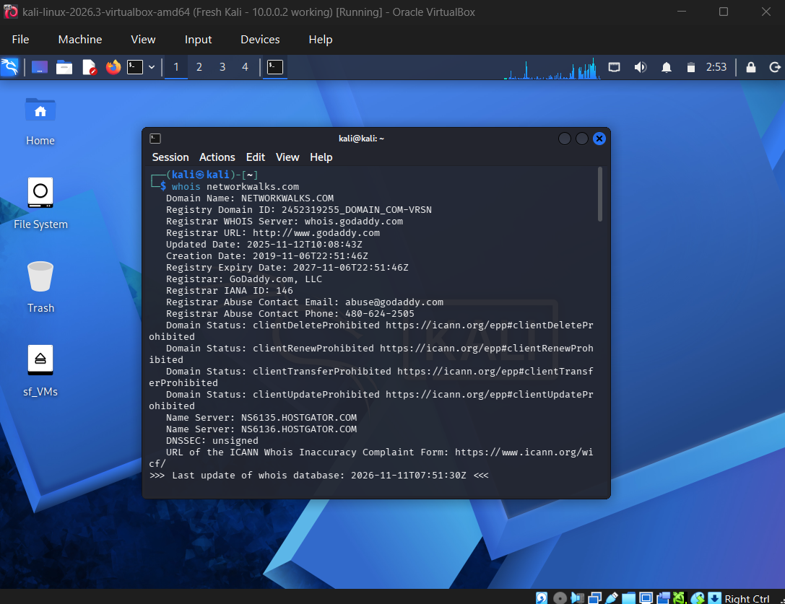
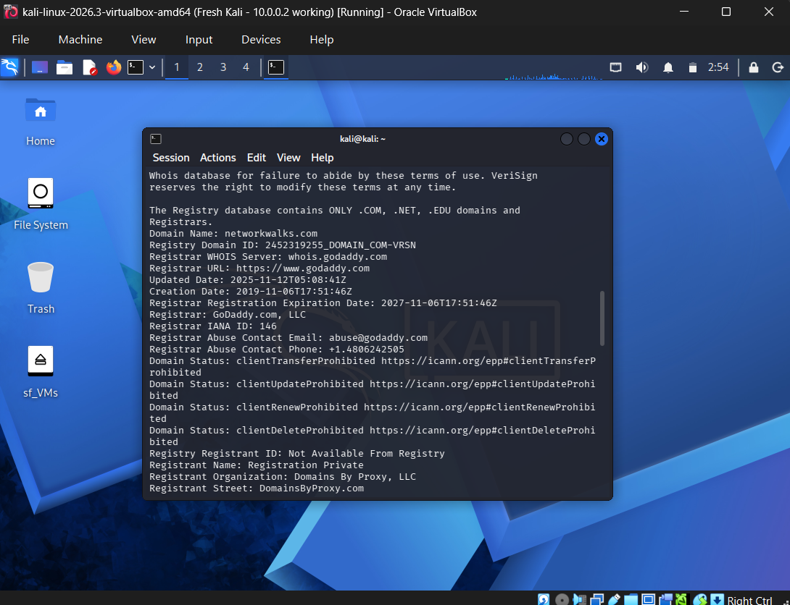
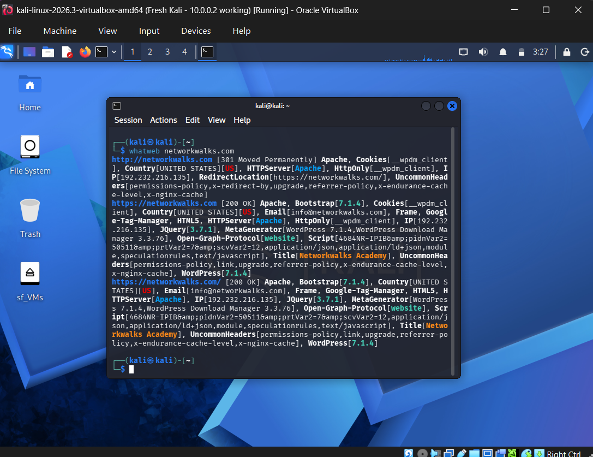
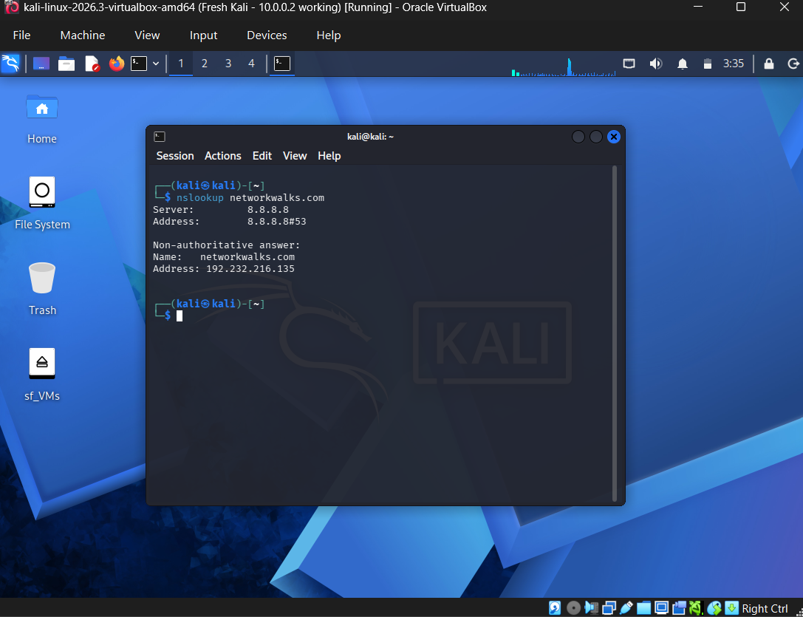
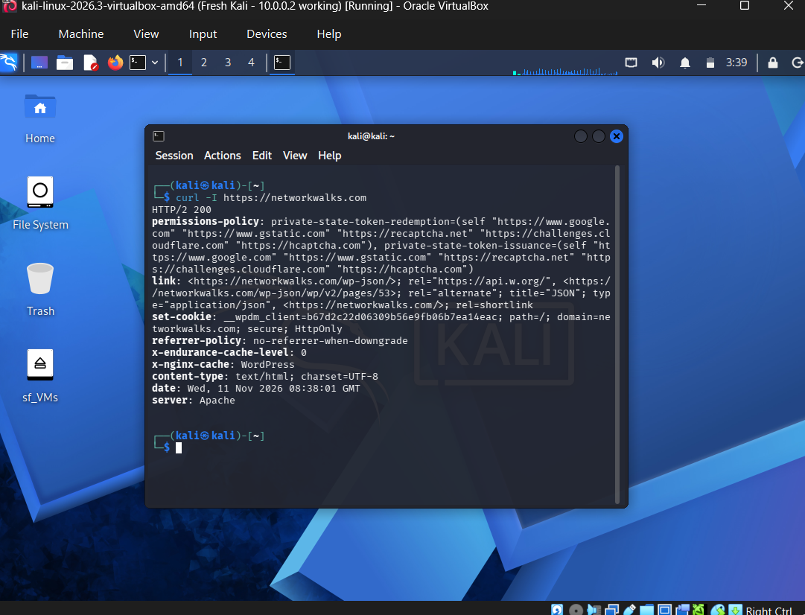
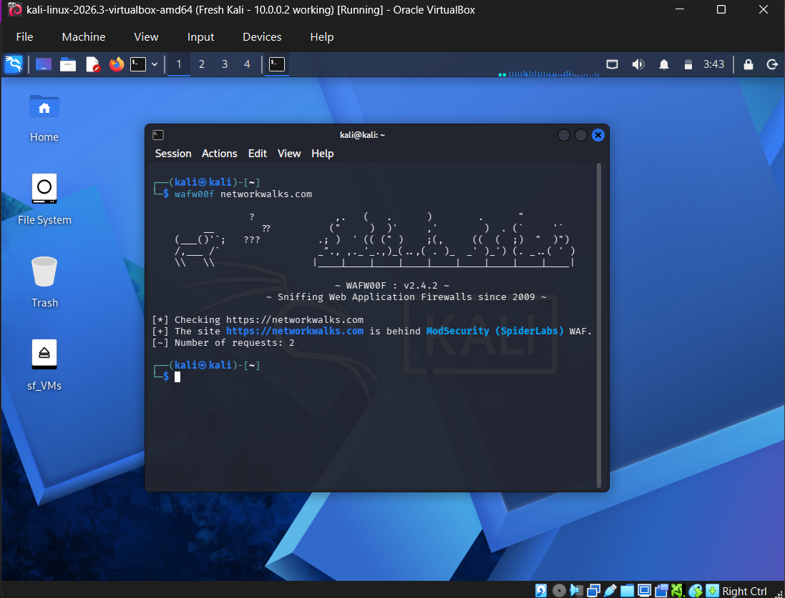
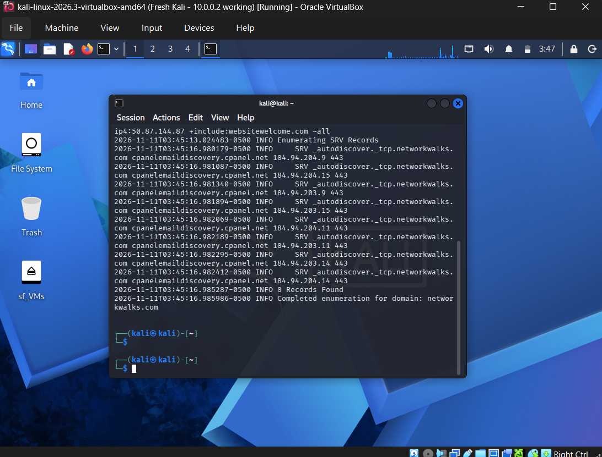

**W2-PM3: Maltego**

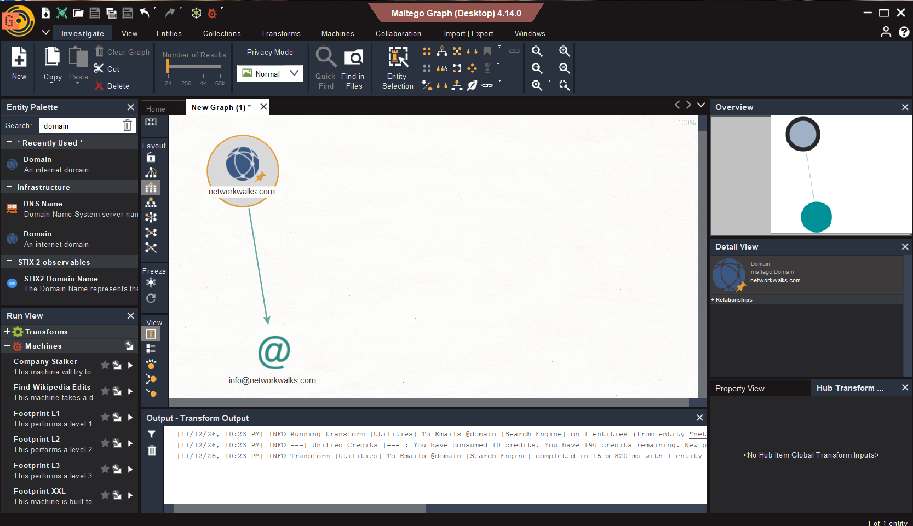

**W2-PM4: theHarvester**

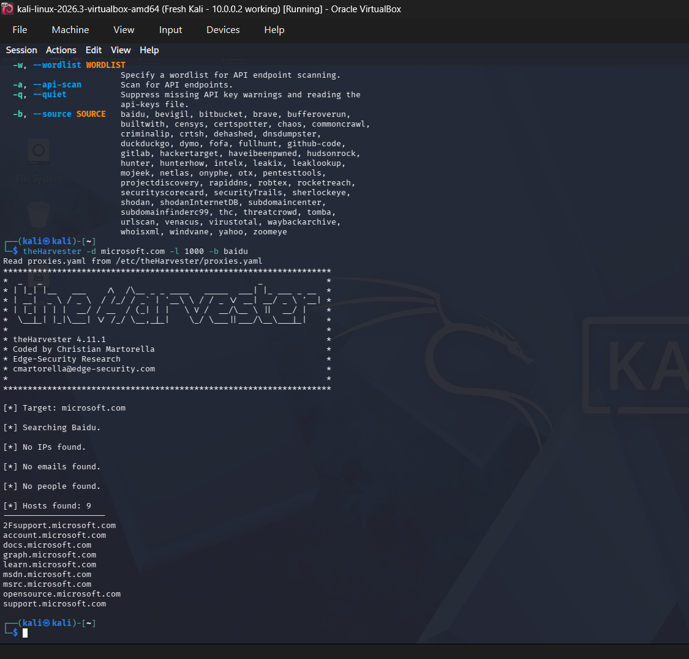
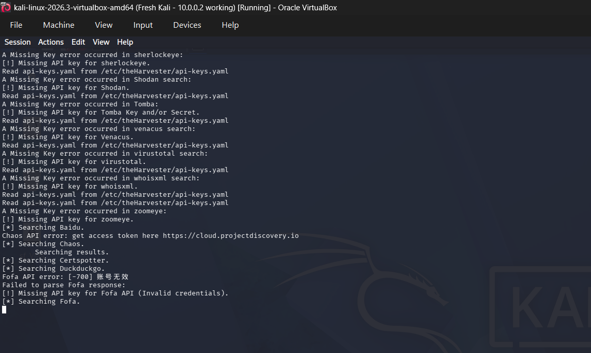

**W2-PM5: Zenmap**

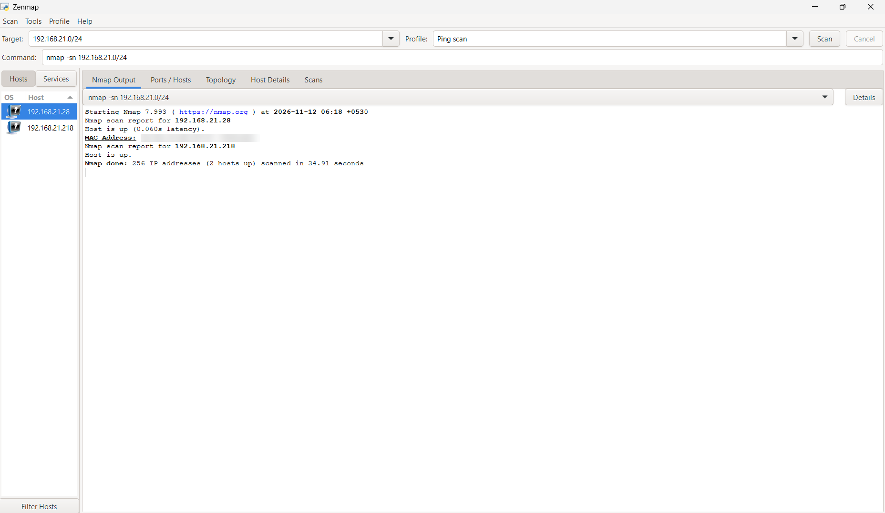

-End-

---

## 👤 Author

**Naadiya Sabrin**
Cybersecurity Intern, Batch B084

## 📌 Project Information

**Program Name:** Cybersecurity program at Networkwalks | **Week:** 02 | **Repository:** GitHub
